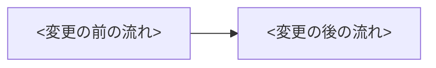

# 意味のカード

作業単位の変更を、人が差分を開かずに確かめるための 1 枚。人が見るのは 2 つの時点に分ける。

- **前半**（`/create-pr` を打つ前。同期の門）: 「この PR を出してよいか」— 範囲・戻せない変更・仕様の値・推奨で進めた判断
- **後半**（checks の間。非同期）: 「意味として抜けていないか」— 挙動の変化・外部システムへの前提・ケースの表・前の巡からの差分。抜けを見つけたら、ユーザーが③として入れる（4 の「質問」の 1 段目）。見つけなければ何もしない。締め切りは人がドラフトを解除する前（series-run の `完了` ではない）

人が見ないもの: 差分の行・テストの中身・型・lint・CI（checks が見る）・コードの不具合（review・recheck・bot・チームのレビュアーが見る）・レビュー指摘の取捨（③の 3 段目）。

## 書き手・置き場所・時点

- **書き手**: coordinator（`tmp/plan.md`・状態ファイルの決定・差分・checks の結果をすべて持つのは coordinator だけ。worker に書かせると巡ごとに書き手が変わり、表現がぶれる）。作業単位ごとに意味を書くので、決まった写しではなく、毎回 LLM が書く
- **置き場所**: `<wt>/tmp/meaning-card.md` と `<wt>/tmp/meaning-card.html`。`/create-pr` の Phase 4.5 が md を読む（`../../create-pr/SKILL.md`）
- **書く時**: 段の型の「pr の工程」の 2（`round: implement`。`/create-pr` の案内の前）と、「checks の工程」の 1 の `前: fix`（`round: fix-<巡>`）。毎回、全体を書き直す（差分の Edit はしない）
- **HTML**: 書いたら毎回 html-view の手順で作り直す（`../../html-view/SKILL.md` を読んで行う。`--style generic --output <wt>/tmp/meaning-card.html`）。mermaid の図はインラインの SVG に描き直す（html-view は外部依存を禁じる）。pr の工程では `/create-pr` の案内と同時に開く。checks の入口では開かず、パスを状態の表と受信箱に出す（`./inbox.md`）

## 書式

<!-- tmp-frontmatter: tmp/meaning-card.md -->
````markdown
---
type: Meaning Card
title: <段名> の意味のカード
description: <変更を 1 文で>
status: stable
head: <書いた時の git -C <wt> rev-parse HEAD>
round: <implement | fix-1 | fix-2>
---
# <段名> の意味のカード

## 前半: この PR を出してよいか

### (a) 範囲
<`tmp/plan.md` の変更対象と `git -C <wt> diff --name-only origin/<base>...HEAD` を比べ、計画の外に触れたファイルを並べる。0 件なら「無い」>

### (b) 戻せない変更
<migration・スキーマ・公開 API・実アカウント・外部への送信に当たる変更（パスと計画から）。当たらなければ「無い」>

### (c) 仕様の値
| 値 | 計画（`tmp/plan.md`・`## ユーザーの決定`） | 実装 |
|----|------|------|

### 推奨で進めた判断
<状態ファイルの `## ユーザーへの依頼` のうち、この作業単位の `推奨で進めた` の③（番号・要旨・推奨）。覆すなら番号で答える。無ければ「無い」>

## 後半: 意味として抜けていないか

### 挙動の変化
<ドメインの言葉で、変更の前と後を「誰が何をすると何が起きるか」で書く>



### (d) 外部システムへの前提（5 行以内）
- <相手のシステム・作成済みの物・認証方式について、この変更が前提にしていること>

### (e) ケースの表（10 行以内。超えた分は「残り」に分ける）
| ケース | 操作 | 期待 |
|--------|------|------|

### (f) 前の巡からの差分
<`round` が fix のときだけ。前のカードの `head` から HEAD までの差分を、意味の変化として書く。implement なら「初回」>
````

- (d)・(e) は `/create-pr` が PR 本文に写す（「前提」の小見出しと、動作確認のチェックリスト）。計画の内部 ID（段の名前・ステップ ID・`Q-<n>`・`K-<n>`）を書かない（PR の読者には意味が無い。`../../create-pr/reference/pr-description-template.md` と同じ）
- (c) の値の対照は、計画が値として決めたもの（期限・件数・文言・権限）に限る。計画に値が無ければ「無い」
- 書いた後、`head` が今の HEAD と同じことを確かめる（`/create-pr` が古いカードを報告するのは、この値との比較）
